<!--
THESIS: A concise technical profile built around real projects and verifiable activity.
OWN-WORLD: Paper, ink, cobalt, and orange form a flat information system with no decorative effects.
STORY: A visitor sees the work, checks one project, and follows the links that matter.
FIRST VIEWPORT: The name leads. A compact activity panel adds context without becoming the identity.
FORM: Technical editorial profile with ENERGY 2, RHYTHM 2, and MOTION 2.
-->

  <a href="https://tahtalabs.com/">Tahta Labs</a>&nbsp;&nbsp;|&nbsp;&nbsp;
  <a href="https://github.com/aksalatdev?tab=repositories">Repositories</a>&nbsp;&nbsp;|&nbsp;&nbsp;
  <a href="https://github.com/amosblomqvist/learnharness/pull/130">Open source</a>

## I build mobile apps, backend services, and automation tools.

Recent projects include a GPS attendance app, a real-time chat system, and a Python document pipeline. I also work on MCP tools and AI agent workflows.

GitHub activity: 660 contributions and 14 pull requests from 28 October 2025 to 28 October 2026. Source: GitHub GraphQL API.

## Open source

In [PR #130](https://github.com/amosblomqvist/learnharness/pull/130), I changed the completion rule so a failed `probe_done` call could not close a probe. The maintainer adapted that part into [v0.3.9](https://github.com/amosblomqvist/learnharness/releases/tag/v0.3.9) and credited my account in the [upstream commit](https://github.com/amosblomqvist/learnharness/commit/f01fdf3260a31091b96f81e6f5f31b14b34b2d3a).

## Selected work

### [Excel to Word to PDF Automation](https://github.com/aksalatdev/Excel2Word2PDF-Automation)

Reads rows from Excel, fills Word templates, and exports PDFs. It handles repetitive document jobs such as invoices, reports, and certificates.

`Python` `Excel` `Word automation`

### [Flutter Presence App](https://github.com/aksalatdev/flutter-pressence-app)

GPS attendance app with separate views for employees and admins. Built with Flutter, Firebase, and GetX.

`Flutter` `Dart` `Firebase` `GetX`

### [Real-time Chat App](https://github.com/aksalatdev/simple-chat-app)

Vue client and Laravel backend, with Pusher delivering messages in real time.

`Laravel` `Vue.js` `Pusher` `PHP`

## Tools

I use Flutter and Dart for mobile apps, TypeScript and Node.js for backend work, Laravel for APIs, Python for automation, and Vue for web interfaces.

Lately, I have been working on MCP tools, AI agent workflows, and the infrastructure around them.

## Elsewhere

More projects and notes live at [tahtalabs.com](https://tahtalabs.com/).
